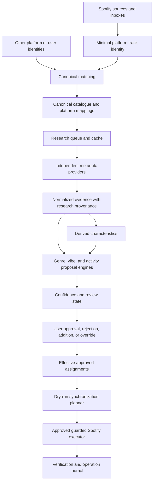

# Phase 0 architecture

Status: Phase 2 offline implementation checkpoint, 2026-08-14. Phase 0 boundaries remain authoritative;
Phase 1 provides local persistence and Phase 2 adds PKCE plus a read-only Spotify adapter without ingestion.

## Design principles

1. The catalogue and classifier are platform-neutral. Spotify is an ingestion/synchronization adapter,
   not the conceptual owner of track identity or classification state.
2. The Spotify adapter supplies the minimum practical identity: title, artist names, and stable platform
   identifiers needed for synchronization. Classification must not depend on Spotify audio analysis,
   audio features, popularity, listening profiles, artwork, previews, recommendations, genre inference,
   or unnecessary album/account metadata.
3. Classification is proposal-oriented, multi-label, versioned, batch-capable, resumable, and reviewable.
4. User decisions outrank generated output. Classification and Spotify mutation are separate processes.
5. Writes are denied by default and available only through the guarded managed-playlist executor.

## Corrected data flow

Derived characteristics are produced from normalized evidence by deterministic rules, Codex
interpretation, or explicit user input. They are never inferred from playlist proposals. Proposal
engines may consume both evidence and existing characteristics. This removes feedback loops and keeps
facts, interpretations, classifications, and decisions auditable.

## Component boundaries

- **Platform ingestion adapters** read permitted source/inbox identities and maintain platform mappings.
- **Canonical matching** proposes relationships between identity records. Title/artist normalization is a
  search key only, never proof of canonical identity. Versions and recordings can remain distinct.
- **Research coordinator** queries cheap structured independent sources first, evaluates sufficiency, then
  requests targeted web research only when needed. Results are normalized and cached.
- **Characteristic derivation** produces reusable concepts such as energy, intensity, vocal character,
  atmosphere, rhythmic drive, or mood, with evidence references and an origin.
- **Proposal engines** use deterministic parent-genre mappings when reliable and Codex more heavily for
  subjective vibe/activity judgments. Activity rules may reuse characteristics.
- **Review/decision service** applies precedence and records explicit corrections for optional calibration.
- **Desired-state builder** sees only effective approved assignments, not raw proposals.
- **Planner** computes an idempotent dry-run diff without a mutation capability.
- **Guarded executor** is the only component receiving the platform write port. It revalidates stable ID,
  role, ownership, operation kind, approval, and current state before any later write.

The Phase 2 Spotify adapter implements only current-account identity, current-user playlist metadata,
playlist items, and saved-track reads. It maps responses immediately to minimal platform-neutral values and
does not persist them. Playlist `/items` with nested `item` is canonical. Because Spotify's current reference
is inconsistent, an isolated nested-`track` fallback may parse responses from the same `/items` endpoint and
records only in-memory variant counts. The deprecated playlist `/tracks` endpoint is never called.

## Dependency rules

The domain layer imports no Spotify, Codex, HTTP, database, or provider implementation. Research and
classification ports do not depend on the platform writer. The synchronization planner does not call a
classifier. Platform implementations map platform IDs to canonical IDs at their boundary.

SQLite is the V1 store under the resolved per-user runtime root. Phase 1 persists established domain
concepts only: taxonomy revisions, catalogue identities/mappings, match assessments, playlist registrations,
evidence, characteristics, proposals, decisions, and calibration selections. Workflow-owned research jobs,
classification batches, desired assignments, sync plans, and operation journals remain deferred.

## Batch and state boundaries

A classification batch will be a deterministic versioned document containing several canonical track IDs,
normalized evidence records, derived characteristics, applicable specifications, and selected calibration
examples. A result will reference the batch/item, taxonomy/specification versions, evidence IDs, and
characteristic IDs. Item-level statuses will allow completed items to remain completed while failed,
ambiguous, or stale items are retried. Content-addressed or stable input fingerprints will support
idempotency; exact schemas are deferred to Phase 1/6.

## V1 boundary

V1 is a manually invoked, human-supervised local application. Codex is the reasoning engine through a
replaceable batch-classifier interface. No local LLM, trained classifier, unattended scheduler, removals,
or destructive reconciliation are included.
