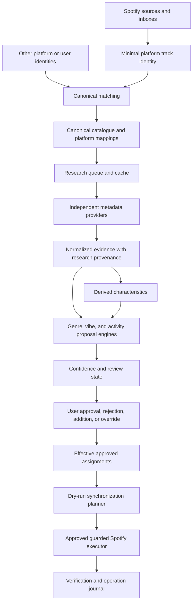

# Phase 0 architecture

Status: Phases 0 through 7 complete, 2026-08-17. Phase 0 boundaries remain authoritative. The Phase 4
source bundle is explicitly human-reviewed. Phase 5 evidence-only research implementation and its authorized
live-provider checkpoint are complete. Phase 6 derives only evidence-supported characteristics and evaluates
reviewed semantic specifications offline; its results remain review-required proposals. Its versioned rules
and evidence references are locally auditable; runtime Genre-variant routing remains downstream.

Phase 7 adds the distinct final local layers: `ResearchEvidence → DerivedCharacteristic →
ClassificationProposal → UserReview/Override → EffectiveReviewedState`. User decisions outrank, but never
erase, generated proposals; calibration compares those layers without automatic tuning or Spotify writes.

## Design principles

1. The catalogue and classifier are platform-neutral. Spotify is an ingestion/synchronization adapter,
   not the conceptual owner of track identity or classification state.
2. The Spotify adapter supplies the minimum practical identity: title, artist names, and stable platform
   identifiers needed for synchronization. Classification must not depend on Spotify audio analysis,
   audio features, popularity, listening profiles, artwork, previews, recommendations, genre inference,
   or unnecessary album/account metadata.
3. Classification is proposal-oriented, multi-label, versioned, batch-capable, resumable, and reviewable.
4. User decisions outrank generated output. Classification and Spotify mutation are separate processes.
5. Writes are denied by default and available only through the guarded managed-playlist executor.

## Corrected data flow



Derived characteristics are produced from normalized evidence by deterministic rules, Codex
interpretation, or explicit user input. They are never inferred from playlist proposals. Proposal
engines may consume both evidence and existing characteristics. This removes feedback loops and keeps
facts, interpretations, classifications, and decisions auditable.

## Component boundaries

- **Platform ingestion adapters** read permitted source/inbox identities and maintain platform mappings.
- **Canonical matching** proposes relationships between identity records. Title/artist normalization is a
  search key only, never proof of canonical identity. Versions and recordings can remain distinct.
- **Research coordinator** queries cheap structured independent sources first, evaluates sufficiency, then
  requests targeted web research only when needed. Results are normalized and cached.
- **Characteristic derivation** produces reusable concepts such as energy, intensity, vocal character,
  atmosphere, rhythmic drive, or mood, with evidence references and an origin.
- **Proposal engines** use deterministic parent-genre mappings when reliable and Codex more heavily for
  subjective vibe/activity judgments. Activity rules may reuse characteristics.
- **Review/decision service** applies precedence and records explicit corrections for optional calibration.
- **Desired-state builder** sees only effective approved assignments, not raw proposals.
- **Planner** computes an idempotent dry-run diff without a mutation capability.
- **Guarded executor** is the only component receiving the platform write port. It revalidates stable ID,
  role, ownership, operation kind, approval, and current state before any later write.

The Phase 2 Spotify adapter implements only current-account identity, current-user playlist metadata,
playlist items, and saved-track reads. It maps responses immediately to minimal platform-neutral values and
does not persist them. Playlist `/items` with nested `item` is authoritative. Phase 3 Checkpoint B observed
that schema across every entry in the complete 48-entry controlled playlist, so the nested-`track`
compatibility fallback was removed. The deprecated playlist `/tracks` endpoint is never called.

## Phase 3 ingestion and matching flow

```text
authenticated account_id binding
  -> explicit SOURCE/INBOX registration
  -> staged paginated scan occurrences
  -> consistency/snapshot validation
  -> atomic current-source publication
  -> publication-eligible, account-scoped identity matching
  -> active link reuse, conservative candidates, or untouched-identity bootstrap
  -> explicit confirm/reject/unlink history
```

`account_id` is the stable account boundary; the current Spotify user ID is refreshable verification
metadata. Playlist discovery is ephemeral until a stable playlist ID is explicitly registered. Ownership
and the playlist's collaborative flag are separate facts, and actual item access determines ingestibility.

Playlist resume re-reads metadata and requires the original `snapshot_id`; a mismatch abandons that cursor
and starts a fresh scan. Saved Tracks has no snapshot and is never offset-resumed across interruptions. Its
complete pass uses total and deterministic initial-page signature guards and therefore has best-effort,
not playlist-snapshot, consistency.

Page ingestion may stage minimal identities, but candidate generation and automatic bootstrap can see only
identities reachable through a currently published source occurrence. Source ordering uses global
`source_position = page_offset + item_index`; versioned content digests do not depend on API page size.

Published scans are immutable. Staging and lifecycle transitions revalidate the active account/source and
unpublished-running state transactionally; publication additionally requires terminal enumeration and a
matching playlist snapshot. Unchanged-snapshot optimization skips enumeration only: reconciliation is run
again so an earlier post-publication matching failure remains recoverable.

Provider identities and canonical tracks are portable global records. Active links, intervention state,
candidates, confirmations, rejections, unlinks, and decision history are account-scoped. Another account
may see an existing canonical relationship as candidate evidence but must explicitly confirm adoption.

The final Phase 3 publication baseline is three completed authoritative scans with one current publication
per source: 48 SOURCE, 506 Saved Tracks INBOX, and 252 playlist-backed Shazam INBOX occurrences. These 806
occurrences resolve to 744 published identities, 740 canonical tracks, and 744 active account-scoped links.
Four ambiguous duplicate cases were explicitly confirmed as existing-canonical links; their competing
create-new candidates were superseded, and no review-required identity remains. No real title, artist,
playlist ID, account ID, or candidate ID belongs in source-controlled documentation.

## Dependency rules

The domain layer imports no Spotify, Codex, HTTP, database, or provider implementation. Research and
classification ports do not depend on the platform writer. The synchronization planner does not call a
classifier. Platform implementations map platform IDs to canonical IDs at their boundary.

SQLite is the V1 store under the resolved per-user runtime root. Phase 1 persists established domain
concepts only: taxonomy revisions, catalogue identities/mappings, match assessments, playlist registrations,
evidence, characteristics, proposals, decisions, and calibration selections. Phase 5 adds research jobs,
provider attempts/assertions, normalized evidence provenance, and cache/freshness state. Classification
batches, desired assignments, sync plans, and operation journals remain deferred.

## Phase 5 research boundary

An explicit bounded canonical-ID request is fingerprinted with its ordered artists, version cues, and
independent identifiers. The coordinator checks deterministic local cache state before invoking enabled
MusicBrainz or Wikidata adapters. Provider assertions retain exact/probable/ambiguous/contextual match and
recording/work/release/artist/project scope; only compact normalized evidence is persisted. MusicBrainz tags
and ratings, Wikidata artist-to-recording inheritance, raw responses, playlist decisions, and Spotify state
are excluded. Sufficiency is recomputed per evidence need and never produces a playlist score.

## Phase 4 source bundle

`config/application.yaml` points to the taxonomy, controlled characteristic vocabulary, and specification
manifest. The manifest maps every stable logical playlist ID to one specification and to centralized overlap
guidance, and references the output-target registry and Genre variant-routing policy. `config validate`
resolves only source-controlled relative paths, validates each document with a strict schema, verifies all
characteristic/operator/value and overlap references, preserves the exact 36-to-36 semantic mapping,
enforces 51 concrete targets, and calculates a deterministic digest over normalized documents.

Genre routing is downstream of semantic Genre qualification. It is language-dominant for lexical vocals,
uses regional then primary project/scene evidence for instrumental/non-lexical recordings, and remains
unresolved when evidence is balanced, missing, or genuinely ambiguous. Routing is exact-version-sensitive;
it never creates Genre evidence or forces a single Genre.

The Genre specification basis is normally `musical_style`. Soundtracks/Scores is the explicit exception:
its `work_context` basis represents documented creation or function for a screen, stage, game, or comparable
work. That exception does not make soundtrack appearance sufficient and does not change independent
style-based Genre overlap.

The bundle is upstream policy input. It contains no track assignments, provider analytical features,
runtime account state, or mutation authority. Loading or validating it does not open SQLite, instantiate a
Spotify reader, contact a provider, or persist a specification version.

## Batch and state boundaries

A classification batch will be a deterministic versioned document containing several canonical track IDs,
normalized evidence records, derived characteristics, applicable specifications, and selected calibration
examples. A result will reference the batch/item, taxonomy/specification versions, evidence IDs, and
characteristic IDs. Item-level statuses will allow completed items to remain completed while failed,
ambiguous, or stale items are retried. Content-addressed or stable input fingerprints will support
idempotency; exact schemas are deferred to Phase 1/6.

## V1 boundary

V1 is a manually invoked, human-supervised local application. Codex is the reasoning engine through a
replaceable batch-classifier interface. No local LLM, trained classifier, unattended scheduler, removals,
or destructive reconciliation are included.
